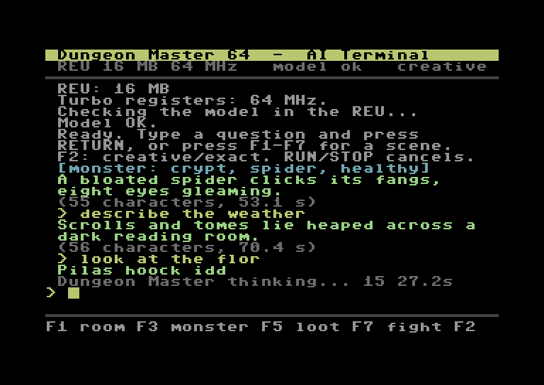
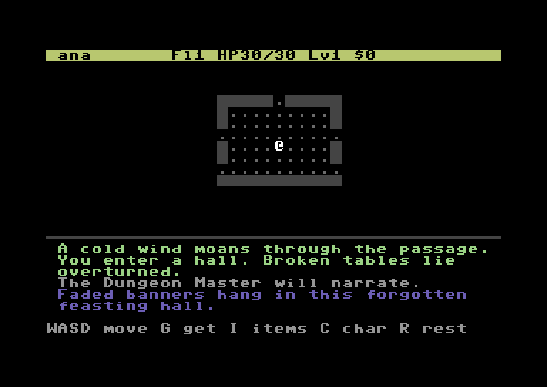

# Dungeon Master 64

**A dungeon adventure with an AI storyteller that runs entirely on a Commodore 64 Ultimate.**

A small transformer language model, trained for this game, lives in the C64's REU. A native 6502 inference engine, written in ACME assembly, computes every character on the C64 itself. No network, no PC, no cloud: just the C64 Ultimate.

The model is the narrator, not the game. The assembly game engine owns every rule, every die roll and every number. The model only describes what the game has already decided. If the model is missing, the game still plays with built-in text.



*The AI terminal on real hardware: an F3 monster scene, then two typed questions. Screen rebuilt from C64 memory read over the network.*



*The dungeon game in VICE. The light blue line was written by the on-device model; the game prints the other text itself.*

## What's in here

| Part | What it is |
| --- | --- |
| **AI engine** (`engine/`) | A reusable language-model inference engine in 6502 assembly: model loading from REU or USB, transformer maths in fixed-point integers, sampling and text output. It matches the Python integer reference bit for bit. |
| **AI terminal** (`DM64.PRG`) | Type a question or press a function key for a scene, and the C64 writes the answer. |
| **Dungeon game** (`DM64GAME.PRG`) | An overhead-view dungeon crawl: five generated floors, three classes, ten monster types, items, locked doors, traps, and a quest for the Amulet of Dawn. The AI Dungeon Master narrates rooms, monsters, fights and treasure. |
| **Model pipeline** (`python/`, `tools/`) | Dataset generator, tokenizer, training, int8 quantization, conversion to the `.d64ai` package format, and a bit-exact integer reference of the C64 engine. |

## The model

| | |
| --- | --- |
| Shape | Transformer, 4 layers, 4 attention heads, 64-wide, ReLU feed-forward 256, context 128 tokens |
| Parameters | 221,760, stored as int8 with per-row scales |
| Vocabulary | 256 tokens: 46 characters, 72 common letter groups (like `the`), control tokens for scenes |
| Package | `DM64AI.REU`, 237 KB, `.d64ai` format 1.1 ([docs/MODEL_FORMAT.md](docs/MODEL_FORMAT.md)) |
| Training data | About 159,000 short fantasy texts generated from an original phrase bank ([docs/MODEL_PIPELINE.md](docs/MODEL_PIPELINE.md)) |

The engine uses no floating point. It works in fixed-point integers, using:

- lookup tables for multiplication (quarter squares) and for the exp function in softmax;
- weights stored as bit planes, so most multiplications become table additions;
- the REU as main storage for weights and attention history, streamed into C64 RAM with DMA.

## Speed

Measured on a C64 Ultimate at 64 MHz with the format 1.1 engine:

| Request | Result |
| --- | --- |
| F1 room scene, 89 characters | 33.4 s, **about 2.7 characters per second** (one run) |
| Same model, previous engine | 1.7–1.9 characters per second |

A one-sentence room description takes 10–30 seconds. In the game you can keep walking while the Dungeon Master is still writing. All hardware measurements are in [docs/HW_RESULTS.md](docs/HW_RESULTS.md); VICE cycle counts are in [docs/ENGINE.md](docs/ENGINE.md).

## Running it on a C64 Ultimate

### What you need

- A Commodore 64 Ultimate (the only machine tested)
- REU enabled, 16 MB
- Turbo Control set to "C64U Turbo Registers" (64 MHz). Without turbo the game starts with the narrator off and uses its built-in text; a terminal answer at 1 MHz takes over half an hour.

### Files

Ready-built files are in the [`dist/`](dist) folder.

| File | Purpose |
| --- | --- |
| `dungeon-master-64.d64` | Disk image with both programs (the model file is too big for a disk; load `DM64AI.REU` separately) |
| `DM64GAME.PRG` | The dungeon game with the AI Dungeon Master |
| `DM64.PRG` | The AI terminal |
| `DM64AI.REU` | The model (load it into the REU) |
| `MANIFEST.JSON` | Model description: shape, tensor layout, SHA-256 |
| `README.TXT` | Player instructions for the Ultimate |

### Steps

1. Copy the files to `/USB1/dist/dungeon-master/` on the Ultimate's USB drive. The programs look for the model there when they load it themselves.
2. In the Ultimate menu (F2), set:
   - **C64 and Cartridge Settings:** RAM Expansion Unit = Enabled, REU Size = 16 MB
   - **U64 Specific Settings:** Turbo Control = C64U Turbo Registers
3. Load the model into the REU, either way:
   - select `DM64AI.REU` in the file browser and choose **Load into REU**, or
   - set Command Interface = Enabled, and the programs load the model from that folder.
4. Run `DM64GAME.PRG` or `DM64.PRG`.

The model stays in the REU through resets. Both programs check it (CRC32) on start.

### Playing the game

Enter a name, choose Warrior, Rogue or Cleric, and find the Amulet of Dawn on the fifth floor.

| Key | Action |
| --- | --- |
| WASD, cursor keys, joystick port 2 | Move; walk into a monster to attack |
| G | Get an item |
| I | Inventory (1–8 to use or wield) |
| C | Character sheet |
| X | Look |
| R | Rest |
| `>` or `.` | Go down the stairs |
| N | Narrator on/off |
| RUN/STOP | Skip the current narration |
| F1 | Help |

### Using the terminal

- Type a question and press RETURN, for example `describe an ancient dungeon`.
- F1 room, F3 monster, F5 treasure, F7 fight: the C64 picks a random scene and narrates it. Scenes give the best text.
- F2 switches between creative (varied) and exact (always the same answer).
- RUN/STOP cancels an answer.

## Building from source

Developed on macOS with:

- [uv](https://docs.astral.sh/uv/) (creates the Python 3.12 virtual environment; packages in `requirements.txt`)
- [ACME](https://sourceforge.net/projects/acme-crossass/) 0.97
- [VICE](https://vice-emu.sourceforge.io/) 3.10 (tests run the engine in the emulator)

```bash
git clone https://github.com/jaydarkseed757/c64-dungeon.git
```

```bash
cd c64-dungeon
```

```bash
make venv
```

```bash
make game terminal
```

```bash
make test
```

Retraining the model from scratch:

```bash
make dataset-v2
```

```bash
make train MODEL=baseline_bpe72_v2
```

```bash
make convert MODEL=baseline_bpe72_v2
```

`make help` lists every target. [docs/DEVELOPMENT.md](docs/DEVELOPMENT.md) covers the workflow, VICE automation and copying files to an Ultimate over the network.

## Repository layout

| Folder | Contents |
| --- | --- |
| `engine/` | The 6502 inference engine (`source/`, `include/`, VICE and hardware test hosts) |
| `terminal/` | The AI terminal |
| `game/` | The dungeon game and its narrator interface |
| `python/` | Model, tokenizer, training, quantization, `.d64ai` writer, integer reference |
| `tools/` | Dataset generator, format validator, VICE harness, profiler, Ultimate upload and hardware checks |
| `configs/` | Model and training configurations |
| `datasets/raw/` | The phrase bank the training data is generated from |
| `models/exported/` | Packaged `.d64ai` models and their manifests |
| `tests/` | Python and VICE tests |
| `docs/` | Design and results documents |
| `release/` | The README shipped to the Ultimate |
| `dist/` | Ready-built programs, model, `.d64` image |

## Status

| Milestone | State |
| --- | --- |
| 1 Research | Done ([docs/REFERENCE_IMPLEMENTATIONS.md](docs/REFERENCE_IMPLEMENTATIONS.md), [docs/ARCHITECTURE.md](docs/ARCHITECTURE.md)) |
| 2 Python model pipeline | Done ([docs/MODEL_PIPELINE.md](docs/MODEL_PIPELINE.md)) |
| 3 Native inference engine | Done, bit-exact with the reference in VICE and on hardware ([docs/ENGINE.md](docs/ENGINE.md)) |
| 4 AI terminal | Done, runs on the C64 Ultimate ([docs/TERMINAL.md](docs/TERMINAL.md)) |
| 5 Dungeon game | Done, runs on the C64 Ultimate ([docs/GAME_DESIGN.md](docs/GAME_DESIGN.md)) |
| 6 AI narration in the game | Done, runs on the C64 Ultimate ([docs/GAME_DESIGN.md](docs/GAME_DESIGN.md) section 10) |
| 7 Optimization and release | Engine 1.76× faster per token in VICE and about 1.4× on hardware; release packaging in progress |

**Known limits:**

- The model mostly recombines sentences from its training phrases.
- Typed free-form questions work less well than the scene keys.
- Text appears at a few characters per second.

## Documents

| Document | Contents |
| --- | --- |
| [docs/ARCHITECTURE.md](docs/ARCHITECTURE.md) | System, model and engine design |
| [docs/ENGINE.md](docs/ENGINE.md) | Engine API, calling convention, memory, VICE cycle profile |
| [docs/INFERENCE.md](docs/INFERENCE.md) | The integer arithmetic contract between engine and reference |
| [docs/MODEL_FORMAT.md](docs/MODEL_FORMAT.md) | The `.d64ai` package format |
| [docs/MODEL_PIPELINE.md](docs/MODEL_PIPELINE.md) | Dataset, tokenizer, training and quantization results |
| [docs/MEMORY_MAP.md](docs/MEMORY_MAP.md) | C64 RAM, zero page and REU allocation |
| [docs/GAME_DESIGN.md](docs/GAME_DESIGN.md) | The dungeon game as built |
| [docs/TERMINAL.md](docs/TERMINAL.md) | The AI terminal |
| [docs/HW_RESULTS.md](docs/HW_RESULTS.md) | Everything measured on the C64 Ultimate |
| [docs/DEVELOPMENT.md](docs/DEVELOPMENT.md) | Prerequisites, make targets, VICE and hardware workflows |
| [docs/REFERENCE_IMPLEMENTATIONS.md](docs/REFERENCE_IMPLEMENTATIONS.md) | Study of Tiny21 and llama2.c64 |
| [docs/FEASIBILITY_AND_RISKS.md](docs/FEASIBILITY_AND_RISKS.md) | Early risk register and benchmark plan |

## Credits

Two earlier C64 language-model projects were studied before this design was chosen:

- **Tiny21** by the Ultimate Experiments contributors ([ReadyOS-C64/UltimateExperiments](https://github.com/ReadyOS-C64/UltimateExperiments), MIT)
- **llama2.c64** by Maciej "YTM/Elysium" Witkowiak ([ytmytm/llama2.c64](https://github.com/ytmytm/llama2.c64))

No code from either project is included. The engine, game, model, training data and tools were written for this project. The training phrases were written with AI assistance.

## License

MIT, see [LICENSE](LICENSE). This covers the source code, the documentation, the training phrase bank, and the trained model files in `models/exported/`.
