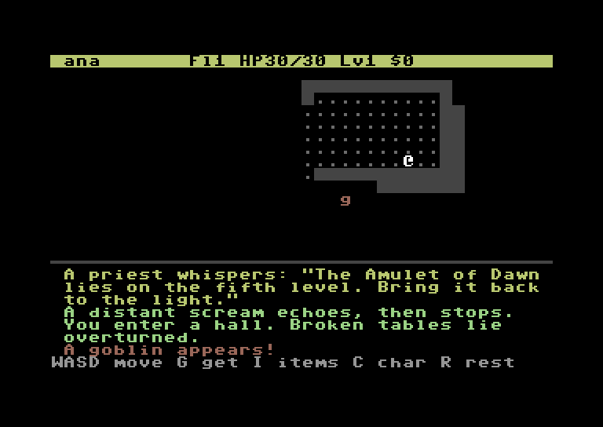
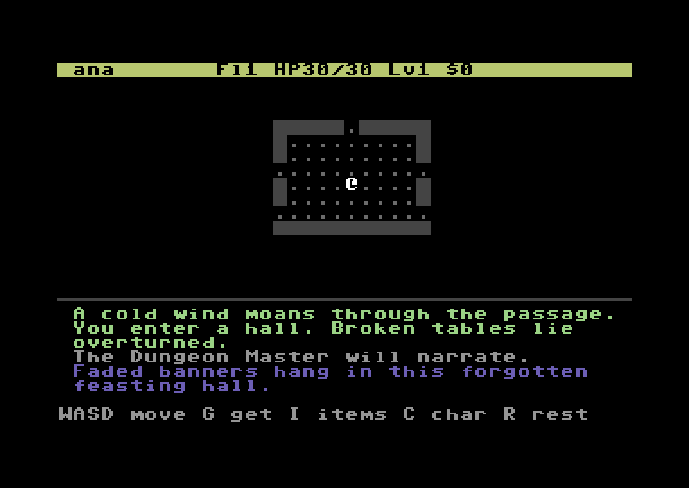

# Game Design — Milestone 5 (game without AI)

Status: Milestone 5, 2026-11-17. **Built and tested in VICE; not yet run on the C64 Ultimate**, which was switched off during this work. Section 9 records what was built.

The game is a traditional overhead-view dungeon RPG in the spirit of Ultima III / Dragon Warrior. Text, graphics and rules are original. **The game owns every rule and every number.** The narrator (Milestone 6) only describes events the game has already decided.

## 1. Goal and flow

1. **Title screen:** enter a name, choose a class (Warrior, Rogue or Cleric).
2. **Quest introduction:** "Recover the Amulet of Dawn from the fifth level of the dungeon."
3. **Five floors**, each generated from the game seed and the floor number, so the same seed gives the same dungeon.
4. **Floor 5** holds the boss room with the dragon and the amulet. Taking the amulet wins the game.
5. **Death** shows a summary, and RETURN starts a new game.

## 2. Map and view

- Map 64 × 32 tiles per floor, one byte per tile (2 KB).
  - Bits 0–4: tile type (wall, floor, door, locked door, stairs, trap).
  - Bit 7: seen.
- The view scrolls with the player: 40 × 15 tiles on screen rows 1–15.
- Visibility: tiles within radius 2 are revealed as the player moves, and a lit room is revealed completely on entry. Monsters are drawn only when within radius 5 of the player.
- Glyphs (mixed-case character set):

| Glyph | Meaning |
| --- | --- |
| reversed space | wall |
| `.` | floor |
| `+` | door |
| `%` | locked door |
| `>` | stairs down |
| `@` | player |
| letters | monsters: `r` rat, `b` bat, `S` skeleton, `g` goblin, `Z` zombie, `s` spider, `O` orc, `T` troll, `M` dark mage, `D` dragon |
| `$` `!` `)` `[` `-` `?` `*` `o` `"` | gold, potion, weapon, armor, key, scroll, gem, ring, amulet |

## 3. Generation (per floor; deterministic from `seed ^ floor`)

1. **Rooms:** up to 9 rooms. Each attempt picks a random size (4–11 × 3–6) and position; a room is rejected if it overlaps another (with a 1-tile margin). At most 60 attempts.
2. **Corridors:** room *i* is joined to room *i−1* with an L-shaped corridor through their centres.
3. **Doors:** where a corridor meets a room's wall ring, a door is placed with 1/3 chance.
4. **Room types:**
   - Room 0 is the entry hall.
   - The last room is the stairs room on floors 1–4, and the boss room on floor 5.
   - The others are drawn from: burial chamber, treasure room, lair, library, armory, secret chamber, trap room, magic chamber, shrine, prison, hall.
5. **Locked doors (floors 2–5):** the stairs or boss room's doors are locked. A flood fill from the start, treating locked doors as walls, picks a reachable floor tile for the key, so every floor is solvable.
6. **Contents by room type:**

| Room type | Contents |
| --- | --- |
| Treasure | Gold and a gem |
| Armory | A weapon or armor |
| Library | A scroll (magic map) |
| Magic chamber | A potion or ring |
| Trap | Hidden traps (damage 1–4 when stepped on, then revealed) |
| Lair | Two extra monsters |
| Every room | 50% chance of a monster |

7. **Locations by floor:** 1 crypt, 2 sewer, 3 mine, 4 cavern, 5 keep. These map to the model's `LOC:*` tokens.

## 4. Characters and rules

**Classes:**

| Class | HP | STR | DEF | Special |
| --- | --- | --- | --- | --- |
| Warrior | 30 | 4 | 2 | — |
| Rogue | 24 | 3 | 3 | Critical hit on 19–20 |
| Cleric | 26 | 3 | 2 | Rest heals 2× |

**Levels:** at XP 20 / 50 / 100 / 180 / 300 / 450 / 650: +6 max HP, +1 STR, and +1 DEF on even levels.

**Monsters** (game-defined; the narrator cannot change them):

| Monster | HP | ATK | DEF | Damage | XP | Floors |
| --- | --- | --- | --- | --- | --- | --- |
| Rat | 3 | 1 | 0 | 1–2 | 2 | 1 |
| Bat | 4 | 2 | 1 | 1–2 | 3 | 1–2 |
| Skeleton | 8 | 3 | 2 | 1–4 | 6 | 1–2 |
| Goblin | 7 | 3 | 1 | 1–4 | 5 | 1–3 |
| Zombie | 12 | 2 | 1 | 2–4 | 8 | 2–3 |
| Spider | 9 | 4 | 2 | 2–4 | 9 | 2–4 |
| Orc | 14 | 5 | 3 | 2–6 | 14 | 3–5 |
| Troll | 24 | 6 | 4 | 3–8 | 25 | 4–5 |
| Dark mage | 14 | 7 | 2 | 3–7 | 22 | 4–5 |
| Dragon | 60 | 9 | 6 | 4–12 | 100 | boss, floor 5 |

**Combat** (bump to attack; d20 = a random number 1–20):

- **Player hits** if d20 + STR + weapon bonus ≥ 10 + monster DEF.
  - Damage is the weapon roll + STR/2.
  - A natural 20 is a critical hit (19–20 for the Rogue) and doubles the damage.
- **A monster hits** if d20 + ATK ≥ 10 + player DEF + armor.
  - Damage is its roll − armor/2, minimum 1.
- A dead monster gives XP and has a 40% chance to drop gold (floor × 1–8).

**Monster turns:** a monster adjacent to the player attacks. One within 6 tiles steps toward the player, if the tile is free. Others stay.

**Items** (inventory of 8):

| Item | Effect |
| --- | --- |
| Gold | Counter |
| Potion | Heals 8–15 |
| Dagger / sword / axe / mace | Damage 1–4 / 2–6 / 2–8 / 3–7 |
| Leather / chain / shield / helm | Armor +1 / +2 / +1 / +1; one of each kind is worn |
| Key | Opens a locked door and is used up |
| Scroll | Reveals the floor map |
| Ring | Permanent +1 DEF |
| Gem | Worth 25 gold |
| Amulet | Quest item |

**Rest (R):** heals 1 HP (2 for the Cleric) unless a monster is within 6 tiles.

## 5. Controls

| Key | Action |
| --- | --- |
| W A S D, cursor keys, joystick port 2 | Move or attack (joystick fire = get) |
| G | Pick up |
| I | Inventory: 1–8 uses or equips an item |
| C | Character sheet |
| X | Look (describes the room again) |
| R | Rest |
| `>` or `.` | Descend stairs |
| F1 | Help |

## 6. Screen

```text
row 0     status: name, floor, HP, level, gold (reverse bar)
rows 1-15 map view (40 x 15)
row 16    separator
rows 17-23 Dungeon Master window (7 lines, word-wrapped, scrolling)
row 24    key help
```

## 7. Narration events (the Milestone 6 interface, built now)

Every narrated moment calls `dm_event` with a **context record** made of the same control tokens the model was trained on, plus a game-chosen **fallback text**. In Milestone 5 only the fallback is printed. In Milestone 6, `dm_event` will hand the record to the engine and print the model's text instead, falling back on any error.

| Event | Context record (tokens) | Fallback example |
| --- | --- | --- |
| Enter a room | `TASK:ROOM LOC:x ROOM:y [MON:z]` | "You enter a burial chamber." |
| Monster seen | `TASK:MONSTER LOC:x MON:z MST:HEALTHY` | "A goblin appears!" |
| Player attacks | `TASK:COMBAT MON:z MST:s ACT:ATTACK OUT:HIT/MISS/CRIT/KILLED HP:h` | "You hit the goblin." |
| Player hurt | `TASK:COMBAT MON:z ACT:ATTACK OUT:HURT HP:h` | "The goblin hits you for 3." |
| Item found | `TASK:TREASURE ITEM:i OUT:FOUND` | "You pick up a sword." |
| Locked door | `TASK:ACTION OBJ:DOOR ACT:OPEN OUT:LOCKED` | "The door is locked." |
| Trap | `TASK:ACTION ACT:SEARCH OUT:TRAP` | "A trap! You take 3 damage." |
| Quest intro | `TASK:QUEST NPC:PRIEST QUEST:FIND_RELIC` | the introduction text |

Numbers (damage, gold) are always printed by the game, never by the narrator.

## 8. Memory (chosen so the engine fits beside the game in Milestone 6)

| Range | Use |
| --- | --- |
| `$0801–$1FFF` | Game code, part 1 |
| `$2000–$4FFF` | **Reserved for the engine** (it ends at `$4E2C`; unused in Milestone 5) |
| `$5000–$5FFF` | Game code, part 3 (free after the engine in Milestone 6) |
| `$6000–$9FFF` | Reserved for engine buffers and the DMA window |
| `$AD00–$B4FF` | Map, 2 KB (RAM under BASIC; `$01 = $36`) |
| `$B500–$BFFF` | Game code part 2 and data tables |
| `$C800–$CFFF` | Game state, monsters, floor items, buffers |
| `$0400` | Screen. The KERNAL stays in (GETIN, jiffy clock). Zero page `$50–$6F`. |

## 9. As built (2026-11-17)



**Code** (`game/source/`, ACME):

| File | Contents |
| --- | --- |
| `game.asm` | Constants, state layout, main loop, keyboard and joystick, title and class choice, end screens |
| `text.asm` | Screen helpers, the word-wrapped Dungeon Master log, inline-string printing, `dm_begin` / `dm_loc` / `dm_tok` / `dm_end` |
| `view.asm` | Map access, visibility, scrolling view, status bar |
| `rules.asm` | Movement, bump combat, monster turns, items, inventory, character sheet, rest, stairs, level-ups, events with fallback text |
| `gen.asm` | The deterministic generator; BFS-based key placement (queue at `$6000–$6FFF`, engine space idle at that time) |
| `data.asm` | Stats tables and fallback sentences |
| `generated/game_tables.asm` | Game id → model token, plus display names. Made by `tools/gen_game_tables.py` from `python/vocab.py`. |

**Memory used:**

| Range | Used |
| --- | --- |
| Part 1 | `$0801–$16BE` (of `$0801–$1FFF`) |
| Part 2 | `$5000–$5E81` (of `$5000–$5FFF`) |
| Part 3 | `$B500–$BDBF` (of `$B500–$BFFF`) |
| Map | `$AD00–$B4FF` |
| State | `$C800–$C9DF` |

The engine's regions stay free for Milestone 6. The PRG is 46.5 KB because ACME zero-fills the gaps between regions.

**Narration records.** Every narrated moment fills `dm_ctx` (length byte + control-token ids) in the model's training order, then prints its fallback text. `tests/test_game.py` checks the order of a combat record against `python/vocab.py` `CONTEXT_ORDER`.

**Tests** (`tests/test_game.py`, VICE):

- All five floors of a game: every non-wall tile connected; the key reachable without passing a locked door; stairs on floors 1–4; the amulet and dragon on floor 5; items and monsters on floor tiles.
- The same seed generates the same floor.
- Combat record order and log text.
- A locked door refuses without a key, then opens and uses the key up.
- Pick-up into the pack.
- Death leads to the end screen; taking the amulet leads to victory.

**Differences from sections 1–8:**

- **Monster visibility:** monsters within 5 steps are shown even in unexplored darkness ("heard").
- **Floor 1:** has no locked doors.
- **Rest:** resting with a monster within 6 steps is refused and costs no turn.
- **Armor:** cannot be taken off once worn.
- **Floors:** cannot be revisited (stairs only go down).
- **Save/load:** not implemented; planned for Milestone 7.

**Not yet done:** a run on the C64 Ultimate hardware, and balance tuning from real play.


## 10. Milestone 6: the AI narrator (2026-11-17)



`DM64GAME.PRG` now contains the engine at `$2000`, and `game/source/narrator.asm` connects it to the game.

**Start-up (`ai_boot`, once per power-on):**

1. Run `AI_INIT`, which detects the REU.
2. Select 64 MHz with `turbo_on` if the turbo registers are enabled.
3. Run `AI_LOAD_MODEL`, requiring the game's vocabulary hash (`$11B711A3`, the shipped bpe72 model).
4. If the REU has no valid model and the Command Interface answers, load `/USB1/dist/dungeon-master/DM64AI.REU` from USB first.
5. The title screen reports the result: awake, no REU, no model, model rejected, or no turbo.
6. **At 1 MHz the narrator starts off.** A sentence would take minutes. N switches it on anyway.

**Narration.** `dm_end` hands the event's context record (`BOS + dm_ctx + SEP`) to the engine for the events in `ai_kinds`:

- arriving on a floor
- entering a room
- a monster's first appearance
- kills (other attacks keep built-in text)
- treasure
- locked and unlocked doors
- traps

Generation settings: at most 48 tokens (about 80 characters), temperature 0.8, top-8, seeded from timers and the turn counter. The text streams into the log in light blue while the help row shows "Dungeon Master thinking... (RUN/STOP)".

**Rules stay with the game:**

- **Numbers:** after narrated text the game prints its own numbers in grey: "+5 XP.", "(-3 HP)", "(+12 gold)".
- **The quest introduction stays built-in.** The model only knows a generic "find the relic" quest and could state the wrong goal.
- **Hits, misses, wounds, potions and rest** stay built-in, to keep turns quick.

**Fallbacks:** the built-in text is used whenever the narrator cannot speak:

- no REU, or no model, or the model was rejected
- the narrator was switched off with N
- an engine error
- RUN/STOP before the first character

RUN/STOP after some text ends the sentence with "...".

**Memory with the engine:**

| Range | Used |
| --- | --- |
| Part 1 | `$0801–$1A7B` |
| Engine | `$2000–$4EA6` |
| Part 2 | `$5000–$5EF7` |
| Part 3 | `$B500–$BDC3` |

Game state uses `$C800–$CA01`, which includes the narrator variables at `$C9E0` and the prompt at `$C9F0`.

**Tests** (`tests/test_narrator.py`, VICE, bring-up bpe72 model):

- the model is found, and the narrator is off without turbo
- with N on and greedy decoding, a room narration equals `python/reference_int.py` for exactly the context record the game built, and the help row is restored
- with no model, the game runs on built-in text and N explains why

**Not yet done:** a run on the C64 Ultimate, and tuning the narration pacing from real play.
