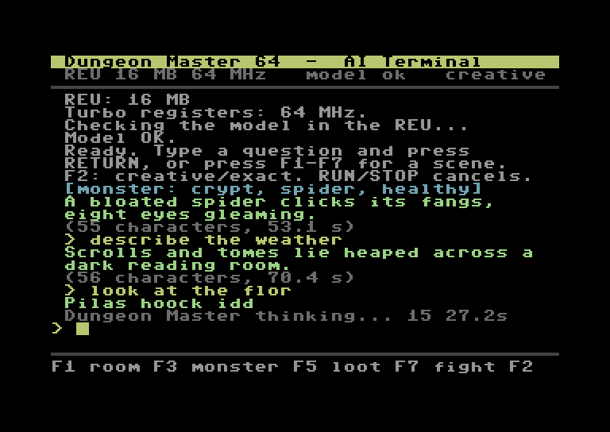

# AI Terminal (Milestone 4)

`terminal/build/dm64.prg` is the first standalone program built on the engine. It is the "critical technical proof" from `CLAUDE.md`: it starts on a C64 Ultimate, finds or loads the custom model, takes a prompt, and generates text on the C64 itself.

**Model change, 2026-11-17:** the terminal now requires a letter-group model, `baseline_bpe72` or the shipped `baseline_bpe72_v2` (same vocabulary hash `$11B711A3`). The measurements below were made with the earlier one-character model. A step writes 1.66 characters on average with the new model, which should give about 1.8 characters/s at 64 MHz; this has not been measured yet. Upload the new `DM64.PRG` and `DM64AI.REU` together: an old terminal refuses the new model and vice versa (`VOCAB` error).

**Status, 2026-11-16:**

- **Verified on the user's C64 Ultimate (64 MHz):**
  - boot
  - model check
  - a typed prompt, in exact mode, identical to `python/reference_int.py`
  - a random fight scene
- **Verified on hardware with the check program, not by the terminal itself:** loading the model file through the Command Interface (`docs/HW_RESULTS.md`, check 3).
- **Verified in VICE only** (`tests/test_terminal.py`):
  - editing and ignoring unknown keys
  - the "no model" message
- **Not verified on hardware:**
  - RUN/STOP cancel
  - F8 quit
  - the terminal's own fallback to loading from file when the REU is empty

## Screen



The capture above was taken on the user's C64 Ultimate during their own session, with `tools/ult_screenshot.py`. It is a text-mode reconstruction from memory read over REST. Since then, the help line has been changed to "F1 room F3 foe F5 loot F7 fight F2 mode", and the thinking line to "Dungeon Master thinking... 45 ch 59.1s".

```text
 Dungeon Master 64  -  AI Terminal          <- title
 REU 16 MB 64 MHz   model ok   exact        <- status: REU size, speed, model, mode
----------------------------------------
 ... boot log, prompts, [scenes], answers   <- output window (rows 3-19), word-wrapped
 (86 characters, 110.4 s)                   <- per answer: length and time (jiffy clock)
Dungeon Master thinking... 42 ch 12.3s      <- row 20 while generating
>  typed prompt                             <- rows 21-22
----------------------------------------
F1 room F3 foe F5 loot F7 fight F2 mode     <- help
```

## Keys

| Key | Action |
| --- | --- |
| Letters, digits, `.,!?'"-:;`, space | Type a prompt, up to 60 characters. Keys the model has no token for are ignored. |
| RETURN | Send the typed prompt as `TASK:FREE` + characters |
| DEL | Delete the last character |
| F1 / F3 / F5 / F7 | Random room / monster ("foe") / treasure / fight scene. The structured context tokens are printed in `[brackets]`. |
| F2 | Toggle creative (temperature 0.8, top-8) / exact (greedy, reproducible) |
| RUN/STOP | Cancel the answer in progress (checked between tokens) |
| F8 | Restore the turbo register and reset |

## Start-up sequence

1. `AI_INIT`: tables, REU detection. With no REU or one under 2 MB, it shows a message and waits for RETURN to retry.
2. `turbo_on` (`engine/source/hw_turbo.asm`): if `$D031` answers, it selects index 15 with badline timing off. Otherwise it warns that it is running at 1 MHz.
3. `AI_LOAD_MODEL` with `AI_PB_EXPECT_HASH` set to the vocabulary hash the terminal was built for. The hash comes from `terminal/source/generated/scene_tables.asm`, made by `tools/gen_terminal_tables.py`.
4. If there is no model (signature) or the CRC fails, and the Command Interface answers, `uci_load_model` (`engine/source/hw_uci.asm`) loads `/USB1/dist/dungeon-master/DM64AI.REU` into REU `$000000`. The model is then checked again.
5. Errors show what to do in the Ultimate menu, and RETURN retries.

## Memory

| Range | Use |
| --- | --- |
| `$0801–$12B6` | Terminal code (must stay below `$2000`; an assembly-time check enforces it) |
| `$2000–$4E2C` | Engine, including `hw_turbo` and `hw_uci` |
| `$4E2D–$557B` | Terminal data: scene tables, texts (must stay below `$6000`) |
| `$C800–$C9FF` | Terminal state block (`$C800`: `"DMT1"`, phase, status, count, mode, model), input, prompt, word buffer |
| Zero page `$50–$59` | Terminal pointers. The engine uses `$10–$4F`. |

The KERNAL IRQ stays enabled, for keyboard scanning, the jiffy clock and the STOP key. `$01 = $36`.

## Building and testing

```bash
make terminal
```

```bash
.venv/bin/python -m pytest -q tests/test_terminal.py
```

```bash
make hw-terminal
```

- `tests/terminal_harness.py` boots the PRG in VICE, feeds keys through the KERNAL keyboard buffer (`$0277`/`$C6`), and reads the screen and output buffer.
- `tools/terminal_hw.py` does the same on the C64 Ultimate through `runners:run_prg`, `machine:writemem` and `machine:readmem`.
- The hardware run needs Turbo Control set to "C64U Turbo Registers". Set it in the menu, or over REST for the run only (see `docs/DEVELOPMENT.md`).

## Measured on the user's C64 Ultimate (64 MHz)

| Request | Output | Time (C64 jiffy clock) |
| --- | --- | --- |
| Boot to "Ready" (model already in the REU, CRC checked) | — | 3.1 s (host clock) |
| Typed `describe an ancient dungeon` (exact) | "A small shrine stands here, its candles long cold. A scrawny goblin stirs in the dark." (86 chars) | 110.4 s (30 prompt tokens + 86 characters) |
| F7 fight scene (creative) `[fight: goblin, miss, your hp mid]` | "You swing wide and miss the goblin." (35 chars) | 35.2 s (6 prompt tokens + 35 characters) |
